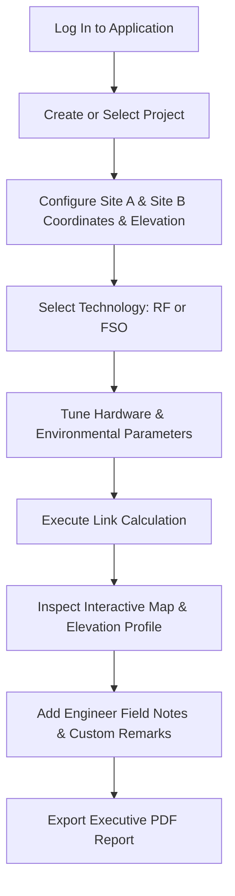

# NAV LINK PLANNER

[](https://laravel.com)
[](https://vuejs.org)
[](https://vitejs.dev)
[](https://php.net)
[](https://getbootstrap.com)
[](https://leafletjs.com)
[](LICENSE)

**NAV LINK PLANNER** is a vendor-independent, enterprise-grade engineering tool designed for Point-to-Point (PtP) **Radio Frequency (RF)** and **Free Space Optical (FSO)** telecommunication link design, Line of Sight (LOS) survey analysis, terrain profiling, and executive PDF reporting.

---

## Table of Contents

- [Key Capabilities](#key-capabilities)
- [System Requirements](#system-requirements)
- [Step-by-Step Installation Guide](#step-by-step-installation-guide)
- [Default Login Credentials](#default-login-credentials)
- [How to Run & Operate the Application](#how-to-run--operate-the-application)
- [Operational Workflow (Step-by-Step Guide)](#operational-workflow-step-by-step-guide)
- [Testing & Verification](#testing--verification)
- [Troubleshooting & FAQ](#troubleshooting--faq)
- [Project Architecture & Directory Structure](#project-architecture--directory-structure)

---

## Key Capabilities

1. **Dual Technology Link Budget Engine**:
   - **RF Workbench**: Free Space Path Loss (FSPL), 1st Fresnel zone clearance radius ($F_1$), Earth curvature drop sagitta ($k=4/3$), mechanical antenna tilt, effective isotropic radiated power (EIRP), receiver sensitivity, fade margin, and MCS throughput estimations across sub-6 GHz, 5 GHz, and millimeter-wave (60 GHz) bands.
   - **FSO Link Engine**: Free Space Optical link analysis using the Kruse atmospheric attenuation model ($\gamma(\lambda)$), geometric divergence loss, optical fade margin, and built-in seasonal visibility baseline databases for 30 major Indian regions.
2. **Dual Coordinate Format Support**:
   - Seamlessly accepts and converts **Decimal Degrees (DD)** (e.g. `19.213388, 77.594562`) and **Degrees, Minutes, Seconds (DMS)** (e.g. `19°12'48.20"N, 77°35'40.43"E`).
   - Intelligent clipboard paste interceptor automatically parses surveyor coordinates and compact strings without browser-stripping.
3. **Automated Terrain & Elevation Profiling**:
   - Integrated Open-Meteo & OpenTopoData SRTM 30m Digital Elevation Model (DEM) auto-lookup for accurate Above Mean Sea Level (AMSL) elevations.
   - Interactive elevation profile charts with clearance and Fresnel zone visualization.
4. **Interactive GIS Mapping**:
   - Responsive Leaflet.js map with OpenStreetMap tiles, real-time antenna marker placement, geodesic path line, and coordinate inspection.
5. **Customer-Ready PDF Reports**:
   - Generates high-resolution branded engineering PDF reports via DomPDF with PHP GD high-dpi graphics (bypassing SVG flip bugs) and persistent engineer custom field remarks.
6. **Multi-Tier Role-Based Access Control**:
   - Three distinct user profiles: **Full Admin**, **Full Technical**, and **Field Engineer**.

---

## System Requirements

Ensure the host environment meets the following specifications:

| Component | Minimum Requirement | Recommended |
|---|---|---|
| **Operating System** | Windows 10/11, Ubuntu 22.04+, macOS | Any modern OS |
| **PHP** | PHP 8.2+ | PHP 8.3+ |
| **PHP Extensions** | `pdo`, `pdo_sqlite` or `pdo_mysql`, `gd`, `mbstring`, `openssl`, `tokenizer`, `xml`, `ctype`, `curl` | PHP GD extension is required for report charts |
| **Database** | SQLite 3 (default zero-config) or MySQL 8.0+ | SQLite for quick start / local |
| **Node.js** | Node.js 18.x | Node.js 20.x or 22.x LTS |
| **Package Managers** | Composer 2.x and NPM 9.x+ | Latest stable |

---

## Step-by-Step Installation Guide

### 1. Clone the Repository

Open your terminal or PowerShell and clone the codebase:

```bash
git clone https://github.com/amicreation/NAV-Link-Planner.git
cd NAV-Link-Planner
```

### 2. Install PHP Dependencies

Install the backend dependencies via Composer:

```bash
composer install
```

### 3. Configure the Environment File

Copy the example environment template to create `.env`:

* **On Windows (PowerShell / Command Prompt)**:
  ```powershell
  copy .env.example .env
  ```
* **On Linux / macOS**:
  ```bash
  cp .env.example .env
  ```

Generate the unique application encryption key:

```bash
php artisan key:generate
```

### 4. Configure the Database

#### Option A: SQLite (Quickest, Zero Configuration - Recommended for Local Run)

Ensure your `.env` contains:
```env
DB_CONNECTION=sqlite
```

Create the SQLite database file if it does not already exist:
* **On Windows (PowerShell)**:
  ```powershell
  if (-not (Test-Path database\database.sqlite)) { New-Item -ItemType File database\database.sqlite }
  ```
* **On Linux / macOS**:
  ```bash
  touch database/database.sqlite
  ```

#### Option B: MySQL

If using MySQL, configure your `.env` credentials:
```env
DB_CONNECTION=mysql
DB_HOST=127.0.0.1
DB_PORT=3306
DB_DATABASE=nav_link_planner
DB_USERNAME=your_username
DB_PASSWORD=your_password
```

### 5. Run Migrations & Database Seeders

Run the database migrations and seed the default user accounts, role permissions, and sample projects:

```bash
php artisan migrate --seed
```

> **Note**: To reset and re-seed the database at any time, execute:
> ```bash
> php artisan migrate:fresh --seed
> ```

### 6. Install Frontend Dependencies & Compile Assets

Install all frontend npm packages and compile assets with Vite:

```bash
npm install
npm run build
```

---

## Default Login Credentials

The application is pre-seeded with three accounts representing different permission tiers:

| Role Profile | Email Address | Password | Permissions & Scope |
|---|---|---|---|
| **Full Admin** | `amitsharma@navwireless.com` | `admin` | Full system access: User Management, Audit Logs, Settings, Equipment Library, all RF & FSO calculation modes, and PDF Reports. |
| **Full Technical** | `tech@navlinkplanner.com` | `password123` | Full engineering access: Advanced FSO Optical link budget parameters, RF Workbench, Equipment Library, and Reports. |
| **Field Engineer** | `engineer@navlinkplanner.com` | `password123` | Field survey access: RF Workbench, FSO Line of Sight (LOS) Survey mode, Equipment Library, and Reports. |

---

## How to Run & Operate the Application

To run NAV LINK PLANNER locally, you will start the Laravel backend and (optionally) the Vite dev server for hot-reload during development.

### Method 1: Standard Development Run (Two Terminals)

**Terminal 1 — Laravel Backend Server:**
```bash
php artisan serve
```
*Application server will listen on `http://127.0.0.1:8000`.*

**Terminal 2 — Frontend Dev Server (Optional for live UI editing):**
```bash
npm run dev
```

### Method 2: Production / Built Mode (Single Terminal)

If you have already executed `npm run build`:
```bash
php artisan serve
```
Open your web browser and navigate directly to:
👉 **`http://127.0.0.1:8000`** (or `http://localhost:8000`)

---

## Operational Workflow (Step-by-Step Guide)



### 1. Authentication
1. Open `http://127.0.0.1:8000` in your web browser.
### 2. Creating a Link Planning Project
1. In the sidebar or workbench, click **New Project**.
2. Enter the **Project Name**, **Customer Name**, **Engineer Name**, and select the primary technology (**RF** or **FSO**).
3. Click **Create Project**.

### 3. Configuring Site Coordinates & Elevation
1. Under **Site A** and **Site B**, specify the site names and coordinates:
   - **Decimal Degrees Mode (DD)**: Enter values like `19.213388` for Latitude and `77.594562` for Longitude.
   - **DMS Mode**: Toggle to DMS to input Degrees (`°`), Minutes (`'`), Seconds (`"`), and Direction (`N`/`S`, `E`/`W`).
   - **Direct Paste**: You can paste surveyor coordinates directly (e.g. `19°12'48.20"N, 77°35'40.43"E` or `19.213388, 77.594562`) into either field. The smart parser automatically parses and converts both coordinates into place.
2. **Ground Elevation (AMSL)**:
   - Click the **Lookup Elevation** button (or leave at `0` for auto-retrieval). The system queries SRTM 30m DEM satellite data to fetch real-world elevation Above Mean Sea Level.
3. **Tower / Mast Height**: Enter the proposed antenna mounting height above ground (in meters).

### 4. Hardware & Technical Parameter Tuning
* **For RF Links**:
  - Select Frequency Band (e.g. `5.8 GHz`, `2.4 GHz`, `60 GHz`).
  - Select Channel Bandwidth (e.g. `20 MHz`, `40 MHz`, `80 MHz`).
  - Set Transmitter Output Power (`dBm`), Antenna Gains (`dBi`), and Cable/Connector Losses (`dB`).
* **For FSO Links**:
  - Choose calculation mode: **Line of Sight (LOS) Survey** or **Full Technical** (available to Technical and Admin profiles).
  - Configure optical wavelength (`850 nm`, `1310 nm`, `1550 nm`), transmitter optical power, beam divergence angle (`mrad`), and receiver optical aperture diameter (`mm`).
  - Select regional location for Kruse atmospheric attenuation modeling based on quarterly/worst-case visibility data across India.

### 5. Running the Calculation
1. Click **Calculate Link Budget**.
2. The calculations engine will evaluate:
   - **Aerial Distance** (WGS84 Haversine distance).
   - **Azimuth & Reverse Azimuth** ($0^\circ - 360^\circ$ bearings for antenna alignment).
   - **Mechanical Antenna Tilt** (accounting for elevation differences and Earth curvature).
   - **Path Loss & Free Space Optical Losses**.
   - **Received Signal Level (RSL)** vs. Receiver Sensitivity.
   - **Fade Margin** and overall Link Feasibility status (**Viable**, **Marginal**, or **Obstructed**).
   - **1st Fresnel Zone Radius** and terrain clearance profile chart.

### 6. Adding Field Notes & Exporting PDF Reports
1. In the **Engineer Custom Remarks** text box, add your survey observations, tower structural notes, or site-specific instructions.
2. Click **Export PDF Report**.
3. A formatted, print-ready engineering document will download immediately, featuring complete site coordinates, link budget breakdown, high-resolution base64 GD PNG elevation graphics, and your custom engineering remarks.

---

## Testing & Verification

The project includes an automated PHPUnit test suite validating geodesic mathematics, DMS string parsers, elevation retrieval, RF link budget equations, and FSO atmospheric attenuation models.

### Run Backend Unit & Feature Tests:
```bash
php artisan test
```
*Expected output: All test cases passing with zero failures.*

### Run Frontend Production Asset Verification:
```bash
npm run build
```
*Expected output: Vite transforms and compiles client assets cleanly.*

---

## Troubleshooting & FAQ

#### Q1: "Database file does not exist" error on startup
**Solution**: SQLite database file needs to be initialized. Run:
```powershell
New-Item -ItemType File database\database.sqlite
php artisan migrate --seed
```

#### Q2: Charts or map graphics are missing in the exported PDF
**Solution**: Ensure the PHP GD extension is enabled in your `php.ini`:
1. Open `php.ini`.
2. Locate `;extension=gd` and remove the leading semicolon: `extension=gd`.
3. Restart `php artisan serve`.

#### Q3: "APP_KEY not set" error
**Solution**: Run:
```bash
php artisan key:generate
```

#### Q4: Elevation lookup returns 0 or fails
**Solution**: Ensure your machine has active internet access. The tool uses Open-Meteo & OpenTopoData public elevation endpoints. If offline, you can manually type the ground elevation AMSL in meters.

---

## Project Architecture & Directory Structure

```
NAV-Link-Planner/
├── app/
│   ├── Http/
│   │   ├── Controllers/          # API & Web controllers (Calculation, Report, Elevation, Auth, Admin)
│   │   └── Requests/             # Form validation & DMS coordinate normalization
│   ├── Models/                   # Eloquent models (Project, Site, Calculation, Report, User, AuditLog)
│   └── Services/                 # Core link engineering engines:
│       ├── GeodesicService.php               # WGS84, Haversine, Azimuth, Tilt, Earth Curvature, DMS Engine
│       ├── RFCalculationService.php          # FSPL, Fresnel zone, EIRP, Fade Margin
│       ├── FSOCalculationService.php         # Kruse atmospheric attenuation, optical link budget
│       ├── ElevationService.php              # SRTM 30m DEM elevation query service
│       └── SvgGeneratorService.php           # GD high-res PNG map & profile generation for DomPDF
├── config/                       # Application, database, and DomPDF configurations
├── database/
│   ├── migrations/               # Database table schemas
│   └── seeders/                  # Default user accounts & sample projects
├── resources/
│   ├── js/
│   │   ├── components/           # Vue 3 components (SiteInputForm, ResultsView, MapComponent, etc.)
│   │   ├── utils/                # Coordinate conversions (DD to DMS, smart paste parser)
│   │   └── app.js                # Vue application entry point
│   └── views/
│       ├── app.blade.php         # Main Single Page Application shell
│       └── pdf/report.blade.php  # Branded PDF customer engineering report template
├── routes/
│   ├── api.php                   # Calculation, elevation, report, and management endpoints
│   └── web.php                   # SPA fallback route
├── tests/
│   └── Unit/EngineeringCalculationTest.php  # Comprehensive engineering test suite
├── DAILY_ENGINEERING_REPORT.md   # Daily engineering timestamp log & architectural records
└── README.md                     # Installation and operations master guide
```

---

## License

This software is developed and distributed under the **[MIT License](LICENSE)**.
